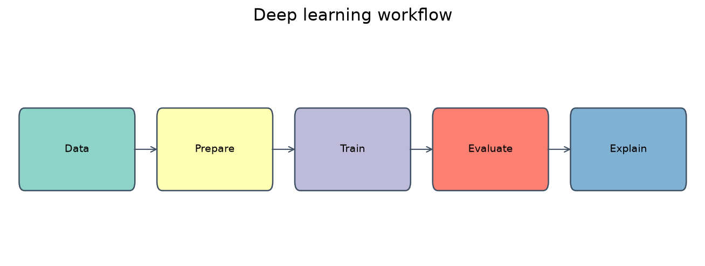
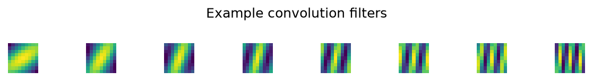
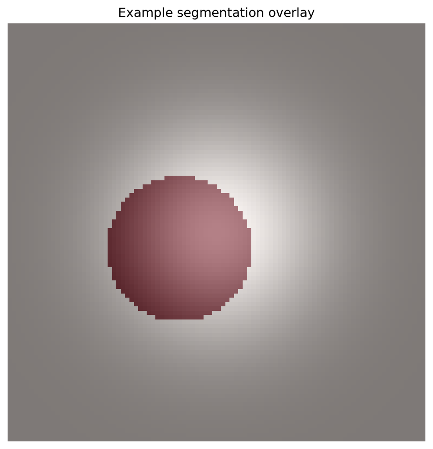
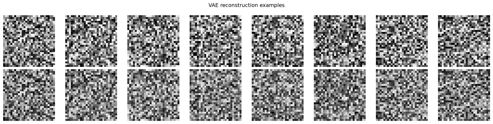
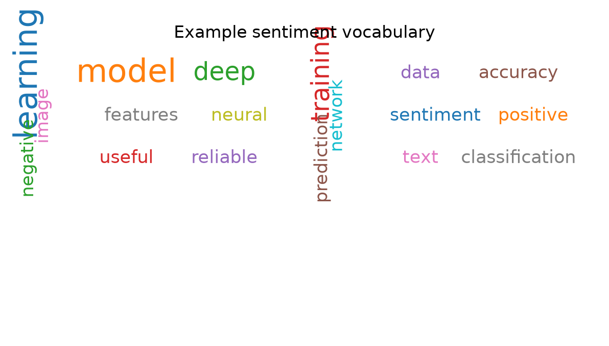
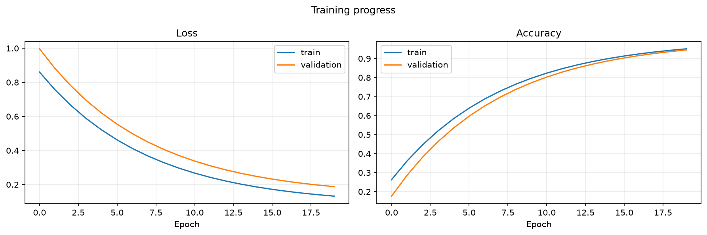
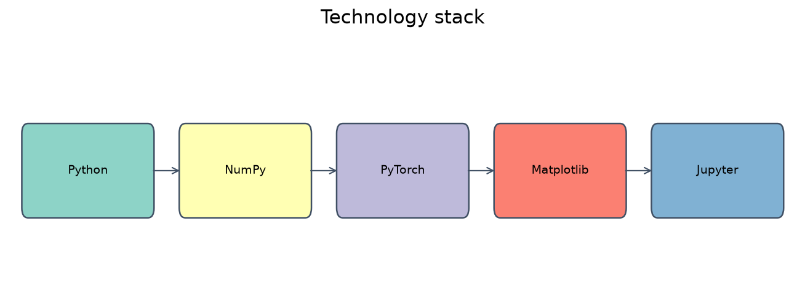
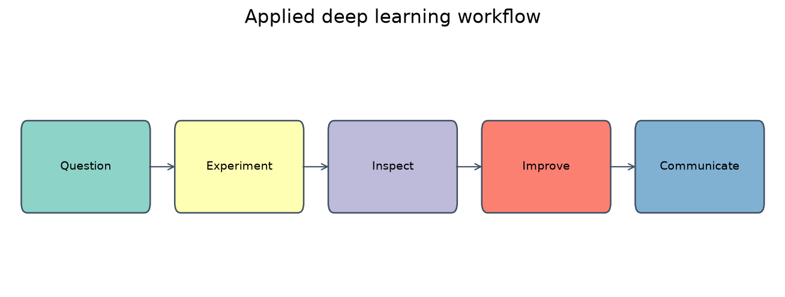

# DAT300 - Applied Deep Learning

[](https://github.com/Mehdij1511/DAT300---Applied-Deep-Learning)

A portfolio-style deep learning project built as part of DAT300 - Applied Deep Learning.  
This repository brings together practical assignments, experiments, and visualizations covering modern deep learning workflows across image analysis, segmentation, generative modeling, and text classification.


## Why this project exists

Modern machine learning is no longer just about training a model once and hoping it works. Real-world problems require understanding:
- how data is represented,
- how models learn patterns,
- how to diagnose poor performance,
- how to interpret hidden activations,
- and how to turn raw experiments into useful insights.

This project addresses that gap by teaching and demonstrating applied deep learning through a set of hands-on assignments:

- Convolutional Neural Networks (CNNs)
- Semantic segmentation with U-Net
- Variational Autoencoders (VAEs)
- Sentiment analysis using text embeddings and classification

The problem this project solves is simple but important:
> How do we move from deep learning theory into real, working, interpretable models that can solve practical tasks?

---

## What problem does it solve?

In many beginner and intermediate ML workflows, the biggest challenge is not writing a model from scratch — it is asking the right questions:

- What does the model actually learn?
- Why is it failing on a certain class?
- How do we inspect intermediate features?
- How do we visualize losses, activations, reconstructions, and predictions?
- How do we use deep learning methods responsibly and interpretably?

This repository solves that by turning abstract ideas into tangible workflows with:
- clean experimental structure,
- visual diagnostics,
- reusable plotting utilities,
- small teaching examples,
- and assignment-oriented practical tasks.



---

## How did it solve it?

The project is organized around a set of applied deep learning tasks, each designed to teach a different concept while reinforcing a common workflow:

### 1. CNNs: learning visual features
The first major component focuses on convolutional neural networks for image classification and feature extraction.

What was done:
- trained or inspected CNN architectures,
- analyzed filters and activation maps,
- examined how early layers detect edges, textures, and shapes,
- used learning curves to monitor training behavior.

Example result:
- a model that learns spatial patterns from images,
- a better intuition about why CNNs work well for vision tasks.



### 2. U-Net segmentation: localizing structure in images
The second task focuses on semantic segmentation, where the model must classify each pixel rather than the whole image.

What was done:
- used U-Net as a segmentation architecture,
- trained on labeled image masks,
- overlayed predicted masks on original input images,
- visually inspected segmentation quality.

This is important because segmentation is not just classification; it requires spatial precision.



### 3. VAEs: learning latent representations
The project also includes Variational Autoencoders, which are used to learn compact latent representations of data.

What was done:
- encoded input data into a latent space,
- reconstructed original images from latent variables,
- compared original vs reconstructed samples,
- examined how latent structure can represent data variability.

This helps students understand:
- representation learning,
- generative modeling,
- latent space compression,
- and the trade-off between reconstruction quality and smooth latent structure.



### 4. Sentiment analysis: text understanding with deep learning
The final domain is natural language processing, where sentiment classification is taught through text-based models.

What was done:
- analyzed text data,
- transformed text into model-friendly representations,
- classified sentiment categories,
- visualized frequent words using word clouds.

This demonstrates how deep learning extends beyond images into language tasks.



---

## What we learned

This project was not just about implementing architectures. It was about learning how to reason with models.

### Lessons from the work:
- Deep learning is not magic — it is a systematic process of data representation, model design, optimization, and interpretation.
- Training curves reveal much more than accuracy scores.
- Feature maps and latent-space visualizations make the model interpretable.
- Generative models teach us how structure can be compressed and reconstructed.
- Segmentation requires spatial understanding, not just classification.
- Text models need careful handling of data preprocessing and vocabulary.
- Visualization is essential. Without it, debugging deep learning systems becomes guesswork.



### Practical takeaways:
- A model can be mathematically valid but still fail due to poor data quality.
- Metrics alone are not enough; inspection matters.
- Good deep learning work includes both predictive performance and qualitative understanding.
- The best way to learn deep learning is to see the model “behave” on real data.

---

## Technology summary

This project is built around a practical Python + deep learning stack, with a focus on learning and experimentation.

Core technologies:
- Python
- NumPy
- SciPy
- Matplotlib
- Seaborn
- Jupyter / JupyterLab
- PyTorch
- TensorFlow / Keras (depending on assignment setup)
- scikit-learn
- Pillow
- WordCloud

Supporting tooling:
- Git and GitHub for versioning and collaboration
- notebooks for reproducible experiments
- plotting utilities for diagnostics and reporting
- lightweight project structure for assignments and visual outputs

This stack keeps the project accessible for students while also reflecting industry-standard workflow patterns for deep learning research and experimentation.



---

## Repository structure

```text
DAT300---Applied-Deep-Learning/
├── README.md
├── CA2-ConvolutionalNeuralNetworks.pdf
├── CA3-SegmanticSegmentationU-net.pdf
├── CA4-VariationalAutoencoders.pdf
├── CA5-SentimentAnalasys.pdf
├── notebooks/
│   └── (student notebooks and experiments)
├── src/
│   └── (scripts and model implementations)
├── utils/
│   └── (helpers and plotting utilities)
├── docs/
│   └── figures/
│       ├── training.png
│       ├── conv_filters.png
│       ├── seg_overlay.png
│       ├── vae_recon.png
│       └── wordcloud.png
├── requirements.txt
└── .github/
    └── workflows/
```

---

## Quick start

1. Clone the repository:

```bash
git clone https://github.com/Mehdij1511/DAT300---Applied-Deep-Learning.git
cd DAT300---Applied-Deep-Learning
```

2. Create a virtual environment:

```bash
python -m venv .venv
source .venv/bin/activate
```

3. Install dependencies:

```bash
pip install -U pip
pip install -r requirements.txt
```

4. Launch Jupyter:

```bash
pip install jupyterlab
jupyter lab
```

5. Open the relevant notebook or script and reproduce the experiments.

---

## Example visualizations

The repository includes a set of reusable plotting examples that can be dropped directly into notebooks:

### Training curves
```python
import matplotlib.pyplot as plt
import seaborn as sns
sns.set(style='whitegrid')

def plot_training(history, out_path='docs/figures/training.png'):
    fig, axs = plt.subplots(1, 2, figsize=(12, 4))
    axs[0].plot(history['loss'], label='train')
    if 'val_loss' in history:
        axs[0].plot(history['val_loss'], label='val')
    axs[0].set_title('Loss')
    axs[0].legend()

    if 'accuracy' in history:
        axs[1].plot(history['accuracy'], label='train')
        if 'val_accuracy' in history:
            axs[1].plot(history['val_accuracy'], label='val')
        axs[1].set_title('Accuracy')
        axs[1].legend()

    plt.tight_layout()
    fig.savefig(out_path, dpi=150)
    plt.close(fig)
```

### CNN filter inspection
```python
import matplotlib.pyplot as plt
import numpy as np

def show_filters(weight_tensor, n_cols=8, out_path='docs/figures/conv_filters.png'):
    filters = weight_tensor.cpu().numpy()
    n = min(filters.shape[0], 64)
    n_rows = int(np.ceil(n / n_cols))
    fig, axes = plt.subplots(n_rows, n_cols, figsize=(n_cols, n_rows))

    for i in range(n):
        ax = axes.flat[i]
        f = filters[i]
        img = f.mean(axis=0)
        ax.imshow((img - img.min()) / (img.max() - img.min()), cmap='viridis')
        ax.axis('off')

    plt.tight_layout()
    fig.savefig(out_path, dpi=150)
    plt.close(fig)
```

### Segmentation overlay
```python
import matplotlib.pyplot as plt

def overlay_segmentation(image, mask, alpha=0.5, out_path='docs/figures/seg_overlay.png'):
    plt.figure(figsize=(6, 6))
    plt.imshow(image, cmap='gray' if image.ndim == 2 else None)
    plt.imshow(mask, cmap='Reds', alpha=alpha)
    plt.axis('off')
    plt.tight_layout()
    plt.savefig(out_path, dpi=150)
    plt.close()
```

### VAE reconstruction
```python
import matplotlib.pyplot as plt

def plot_reconstructions(x, x_recon, n=8, out_path='docs/figures/vae_recon.png'):
    plt.figure(figsize=(2 * n, 4))
    for i in range(n):
        plt.subplot(2, n, i + 1)
        plt.imshow((x[i] * 255).astype('uint8'))
        plt.axis('off')
        plt.subplot(2, n, n + i + 1)
        plt.imshow((x_recon[i] * 255).astype('uint8'))
        plt.axis('off')
    plt.tight_layout()
    plt.savefig(out_path, dpi=150)
    plt.close()
```

### Word cloud
```python
from wordcloud import WordCloud
import matplotlib.pyplot as plt

def save_wordcloud(text, out_path='docs/figures/wordcloud.png'):
    wc = WordCloud(width=800, height=400, background_color='white').generate(text)
    plt.figure(figsize=(10, 5))
    plt.imshow(wc, interpolation='bilinear')
    plt.axis('off')
    plt.tight_layout()
    plt.savefig(out_path, dpi=150)
    plt.close()
```

---

## Why this matters

This project is valuable because it demonstrates the full loop of applied deep learning:

- understand the problem,
- prepare the data,
- design or choose the architecture,
- train the model,
- diagnose failure modes,
- visualize results,
- and communicate insights clearly.

This is the same mindset used in real research, industry prototyping, and portfolio-building ML work.



---

## Portfolio-style summary

This project represents an applied deep learning portfolio centered around:
- image understanding,
- generative modeling,
- segmentation,
- and NLP sentiment classification.

It is designed to show not just theoretical knowledge, but also practical understanding:
- how models are trained,
- how visualizations help diagnose learning,
- and how deep learning can be translated from concepts to results.

The result is a repository that is both educational and portfolio-ready.

---

## How to contribute

- Add runnable notebooks to `notebooks/`
- Add scripts to `src/`
- Add utilities to `utils/`
- Save visual outputs to `docs/figures/`
- Keep examples self-contained and reproducible
- Avoid committing large datasets; prefer small fixtures or public sample data
- Open a pull request with clear notes on what was added or improved

---

## License

This repository is intended for academic and learning purposes.  
Check with the course owner for project-specific licensing terms.

If you want, I can also add an MIT license file or create a more polished version of this README with a stronger portfolio aesthetic and more specific project screenshots/section branding.

---

If you’d like, I can:
- add example notebooks that generate the visualizations above,
- create a `requirements.txt` and CI workflow to run tests/docs,
- generate and commit example figures into `docs/figures/` so the README shows images.
